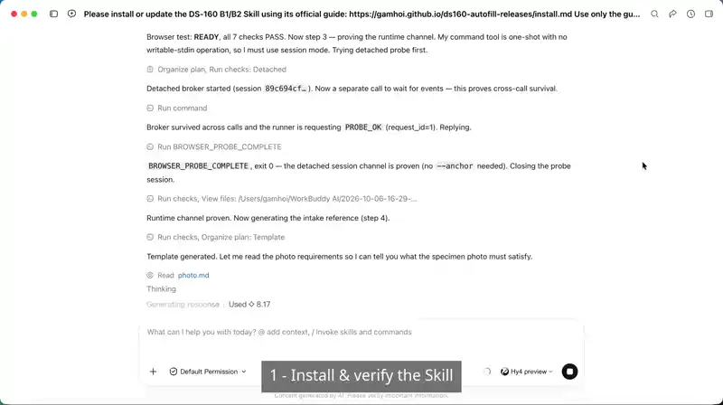
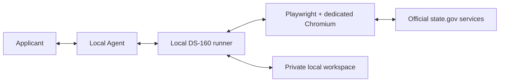

# DS-160 B1/B2 Autofill Skill

**English** | [简体中文](README.zh-CN.md)

A local Agent Skill for assisted DS-160 B1/B2 preparation and form filling.
Personal B1/B2 use is permanently free.

The Skill turns applicant material into a validated local profile, operates the
official CEAC website through a dedicated visible browser, and pauses for human input
at CAPTCHA, Review, correction, E-Sign, and submission boundaries. It is not an
immigration-advice service and is not affiliated with or endorsed by the U.S.
Department of State.

## Quick Start

1. Send this prompt to an Agent with a terminal and a headed browser or Linux Xvfb:

```text
Please install or update the DS-160 B1/B2 Skill using its official guide:
https://gamhoi.github.io/ds160-autofill-releases/install.md
If this URL is unavailable, use the identical Gitee mirror:
https://gitee.com/gamhoi/ds160-autofill-releases/raw/master/install.md

Use only the guide's public installer. Installation does not authorize filling,
electronic signing, or submission; ask me separately before each of those actions.
On a desktop Agent, install the Skill in its persistent user-level Skills
directory so it is available in later tasks. On a web Agent without account-level
registration for shell-installed Skills, install it in this task's verified
VM-persistent directory and read SKILL.md from that path. Keep a separate private
data root. Check task isolation before storing applicant material there.
```

2. After the Agent reports that installation, the browser test, and the runtime
   channel are ready, provide the applicant documents and answer missing factual
   questions.
3. Read CAPTCHAs yourself, review every section against the source material, and
   authorize electronic signing or submission separately only when ready.

The Agent installation protocol is at [install.md](install.md). The installer selects
the current stable version from `stable.json`, verifies the release archive and binary
identity, installs the pinned browser driver, and returns exact verification steps.
The same installer and ZIP files are available from the
[Gitee mirror](https://gitee.com/gamhoi/ds160-autofill-releases); the installer can
select the faster responding official manifest source or use `--source github|gitee` explicitly.

## See It Work



The demonstration uses fictional applicant material. It shows Agent installation,
local profile preparation, a visible dedicated browser, human CAPTCHA entry, rapid
form filling, correction replay, Review, explicit submission authorization, and the
downloaded confirmation document.

## How It Works



There is no project-operated applicant-data backend. Applicant files remain in the
runner's workspace, which may be on the user's desktop or the web Agent's task VM.
Values and photos are transmitted when filling the official CEAC and `state.gov`
photo-service pages. Installation contacts the selected
GitHub or Gitee mirror and may contact npm and the Playwright browser distribution service.

[Read the architecture and data-flow details](docs/architecture.md).

## Supported Systems

| Platform | Architecture |
| --- | --- |
| Windows | x64 |
| macOS | Intel x64 |
| macOS | Apple Silicon ARM64 |
| Linux | x64 (Ubuntu 22.04/24.04 or Debian 12/13) |

Node.js 20 or newer and npm are installation dependencies. The installed runtime is a
platform executable; Playwright and Chrome for Testing are installed separately and
pinned to the supported version. Linux requires a non-root runtime user, Chromium
system dependencies, and a working X11 display or Xvfb. The installer, setup, and
sessions must run as the same user. On a web Agent, choose a task directory proven to
survive VM replacement; account-level Skill registration is host-specific. See the
[installation protocol](install.md) for the required setup and cross-call probe.

## Trust, Privacy, and Limitations

- The installer is public and source-readable.
- Release archives have a fixed file allowlist, SHA-256 checksums, and embedded
  version/build identity checks.
- The runtime does not use a developer account, analytics endpoint, telemetry
  collector, licensing server, or applicant-data backend.
- macOS executables use identity-free ad-hoc signatures; they have no maintainer
  Developer ID or notarization. The Windows executable has no Authenticode publisher
  signature. Checksums verify integrity, not publisher identity.
- The applicant remains responsible for the accuracy of all answers and for the final
  decision to sign and submit.

Read the [security model](docs/security.md), [privacy statement](docs/privacy.md), and
[personal-use license](LICENSE.txt) before installation.

## Documentation

| Topic | Document |
| --- | --- |
| Install or update | [Agent installation protocol](install.md) |
| Architecture and local data flow | [Architecture](docs/architecture.md) |
| Trust boundaries and publisher identity | [Security](docs/security.md) |
| Applicant-data handling | [Privacy](docs/privacy.md) |
| Installation failures | [Troubleshooting](docs/troubleshooting.md) |
| Update, rollback, and uninstall | [Maintenance](docs/maintenance.md) |
| Maintainer-directed candidates | [Release testing](docs/release-testing.md) |

Platform packages and immutable manifests are published under
[GitHub Releases](https://github.com/gamhoi/ds160-autofill-releases/releases) and
[Gitee Releases](https://gitee.com/gamhoi/ds160-autofill-releases/releases). For
questions, compatibility reports, or feature requests, open an issue in this
repository. Do not attach applicant profiles, photos, CAPTCHA images, logs containing
answers, or downloaded application documents.

## Support the Project

DS-160 Autofill is completely free for personal, non-commercial use.

If this tool saved you time, you can buy the developer a coffee to support ongoing
maintenance and updates.

**Support is entirely optional and does not affect any functionality.**

<table>
  <tr>
    <td align="center" width="50%">
      <a href="assets/alipay-support.png"></a><br>
      <strong>Alipay</strong>
    </td>
    <td align="center" width="50%">
      <a href="https://buymeacoffee.com/gamhoi"></a><br>
      <strong>Buy Me a Coffee</strong>
    </td>
  </tr>
</table>

Commercial use requires separate authorization.
